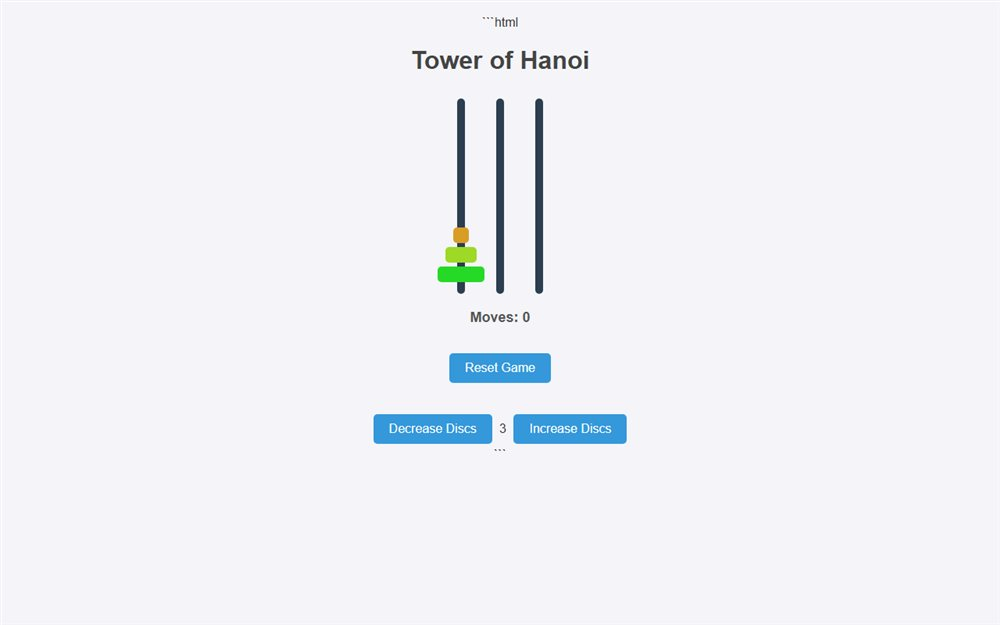

# Tower of Hanoi

The classic three-peg Tower of Hanoi puzzle in the browser - move the stack, one disc at a time.

**[Open the live site](https://ajeet-iitk.github.io/Hanoi1/)**

## What it does

Move the whole stack from the first peg to the last without ever putting a larger disc on a smaller one. The page tracks your moves and lets you restart when a sequence goes wrong.

## Run locally

Open `index.html`, or play the hosted build:

<https://ajeet-iitk.github.io/Hanoi1/>

## Files

| File | Purpose |
| --- | --- |
| `index.html` | Landing page |
| `hanoi1.html` | The puzzle |

---

Part of [my collection of small projects](https://github.com/Ajeet-iitk).
